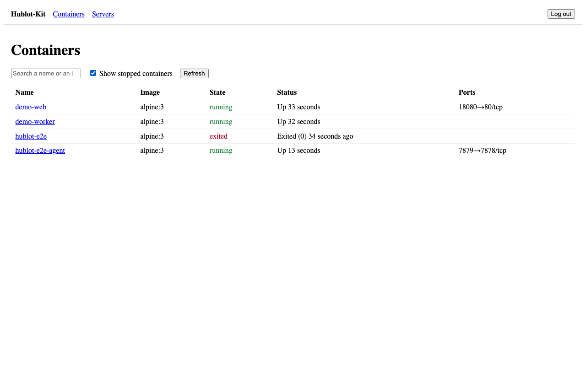
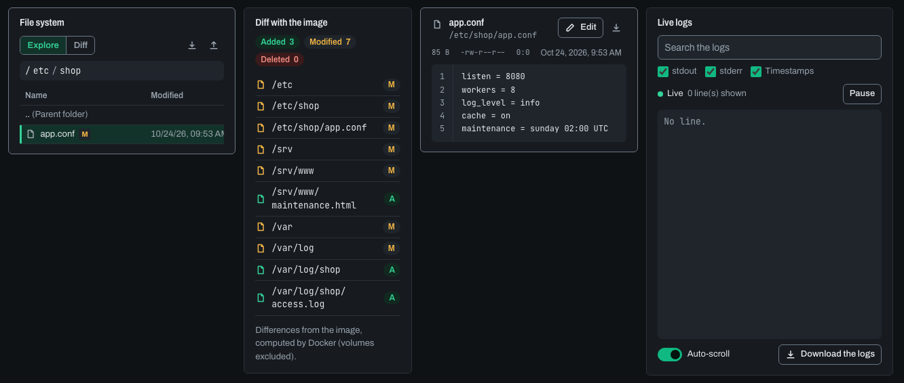

# Hublot-Kit

> **Sécurité : installer Hublot-Kit revient à lui donner les droits root sur l'hôte.**
> Il parle au socket Docker et lit les fichiers de vos conteneurs. Gardez-le sur `127.0.0.1` et accédez-y par un
> tunnel SSH ou un reverse proxy HTTPS. Lisez d'abord [le modèle de sécurité](docs/fr/securite.md).

[Read in English](README.md)

Explorer l'intérieur des conteneurs Docker d'un serveur depuis un navigateur, sans terminal. Choisissez un conteneur
et voyez ses fichiers, ce qui a changé depuis son image, ses logs et sa configuration ; parcourez les fichiers d'une
image ; prenez une photo des fichiers d'un conteneur pour la comparer plus tard.




## Ce qu'il fait (v0.2)

- **Conteneurs** : nom, image, projet Compose, statut, ports, durée de fonctionnement ; onglets, filtres, chiffres
  clés (fichiers, taille de l'image, taille du conteneur) et labels, filtrés.
- **Fichiers** : toute l'arborescence d'un conteneur actif ou arrêté, aperçu texte et image, taille, propriétaire,
  droits.
- **Téléchargement** d'un fichier, ou d'un dossier en archive tar.
- **Édition** d'un fichier texte ou **envoi** d'un fichier, après une confirmation qui rappelle le conteneur et le
  chemin.
- **Diff avec l'image** : ce qui a été ajouté, modifié ou supprimé depuis l'image, et le diff ligne à ligne d'un
  fichier modifié entre sa version dans l'image et dans le conteneur.
- **Logs** : flux en direct, recherche, pause et reprise, téléchargement.
- **Radiographie** : image, état, commande, environnement (secrets masqués, révélés un par un et journalisés), ports,
  réseaux, montages.
- **Images** : toutes les images du démon, leurs couches et leur configuration (masquée), et leurs fichiers en
  lecture seule, sans créer de conteneur.
- **Snapshots** : une photo des fichiers d'un conteneur (métadonnées et empreinte à clé, jamais le contenu), comparée
  à une autre photo ou au conteneur actuel.
- **Secrets** : les noms de tout ce que l'agent masque, dans tous les conteneurs ; jamais une valeur, sauf révélée,
  une à la fois.
- **Recherche** (`Ctrl K`) : conteneurs, projets Compose, pages, et fichiers d'un index déjà construit.
- **Thèmes** : sombre par défaut, clair à la demande, mémorisé dans le navigateur.
- **Lecture seule** (`--read-only`) : aucune écriture dans les conteneurs ; l'interface montre l'état réel de l'agent.

Un serveur, un utilisateur, une interface en français et en anglais, un seul binaire statique avec l'interface
embarquée, pas de base de données, aucune télémétrie. Les process et ressources, le démarrage et l'arrêt, et un
terminal web sont reportés après la v0.2.

## Démarrage rapide

Prérequis : Linux amd64 ou arm64, noyau 5.6 ou plus récent (5.8 pour éditer les fichiers d'un conteneur actif),
Docker Engine avec l'API 1.44 ou plus récente, stockage overlay2 ou containerd. La même commande sert sur les hôtes
AppArmor (Ubuntu, Debian) et SELinux (Fedora, RHEL) ; [à quoi sert chaque option](docs/fr/installation.md#à-quoi-sert-chaque-option).

```sh
docker run -d --name hublot-kit \
  --pid=host --cgroupns=host --cap-add SYS_PTRACE \
  --security-opt apparmor=unconfined \
  --security-opt label=disable \
  -v /var/run/docker.sock:/var/run/docker.sock \
  -v hublot-data:/data \
  -p 127.0.0.1:7878:7878 \
  ghcr.io/levy-cmd/hublot-kit:0.2
```

Le jeton d'accès s'affiche une seule fois, au premier lancement, sur la ligne
`Access token (shown only once): …` (les messages de l'agent sont en anglais).

```sh
docker logs hublot-kit
```

Depuis votre ordinateur, ouvrez un tunnel, puis allez sur <http://127.0.0.1:7878> et collez le jeton.

```sh
ssh -L 7878:127.0.0.1:7878 user@server
```

Vous préférez un binaire lancé par systemd ? Voir [Binaire et systemd](docs/fr/installation.md#binaire-et-systemd).

## Documentation

- [Visite de l'interface](docs/fr/guide.md) : la disposition, la recherche, les panneaux, les pages Images, Secrets
  et Snapshots, le thème, la lecture seule telle que l'interface la montre.
- [Installation](docs/fr/installation.md) : Docker, binaire et systemd, reverse proxy, jeton, mise à jour,
  désinstallation, vérification des signatures et des SBOM d'une release.
- [Modèle de sécurité](docs/fr/securite.md) : ce que l'agent peut faire, ce qui le protège, comment l'exposer.
- [Limites connues](docs/fr/limites.md) : ce que Hublot-Kit ne fait pas, ou ne détecte pas.

## Développement

Prérequis : Go 1.27 ou plus récent, Node 24 (22.17 ou plus récent), Docker. Le code Go qui touche `/proc` ne tourne
que sous Linux : `make test-linux` le lance en root dans un conteneur `golang`.

```sh
make test
make build
make test-linux
```

Sur macOS (Docker Desktop), `/proc/<pid>/root` n'existe que dans la machine virtuelle de Docker : l'agent tourne donc
dans un conteneur, `make web && scripts/dev-agent.sh`. L'interface en mode développement passe par un proxy vers
l'agent sur `127.0.0.1:7878` : `cd web && npm run dev`. Les specs techniques sont dans docs/superpowers/specs :
[v0.1](docs/superpowers/specs/2026-10-07-hublot-kit-v0.1-design.md), la référence, et
[v0.2](docs/superpowers/specs/2026-10-23-hublot-kit-v0.2-design.md), son complément.

## Licence

[MIT](LICENSE)
